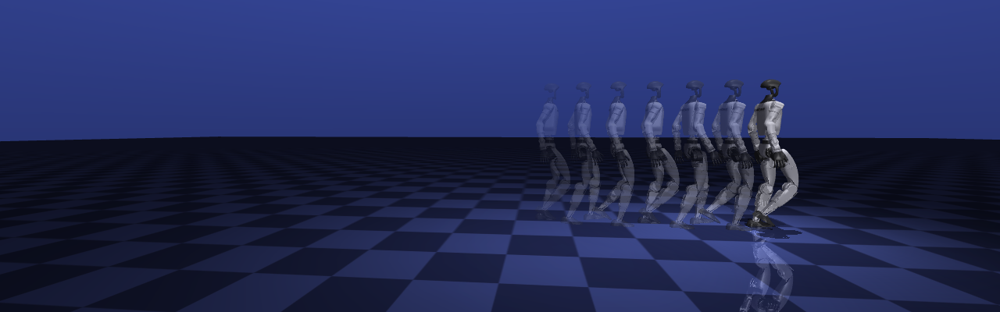

# Humanoid Walking Lab

Learning humanoid locomotion by rebuilding it from the ground up: from a single pendulum in MuJoCo to a
Unitree G1 walking with trained neural-network policies, first in plain MuJoCo and then in ROS 2 + Gazebo.

Weekly write-ups: **[sakshaymahna.github.io/humanoid-walking-lab](https://sakshaymahna.github.io/humanoid-walking-lab/)**

<p align="center">
  
</p>

## What's in here

1. **MuJoCo from scratch** ([`exercises/`](exercises/)). A step-by-step path: inspect a robot model, PD control
   on a pendulum, build a simulatable G1 (actuators, motor models, keyframes), compute the observations a policy
   sees, and run a trained ONNX policy in a 50 Hz control loop. No training framework involved.
2. **Two walking policies on the same robot.** Diego López's `walk.onnx`
   ([2025-tfg-diego-lopez](https://github.com/RoboticsLabURJC/2025-tfg-diego-lopez)) and Unitree's velocity
   policy ([unitree_rl_mjlab](https://github.com/unitreerobotics/unitree_rl_mjlab)), both trained with
   [mjlab](https://github.com/mujocolab/mjlab), replayed and compared in MuJoCo.
3. **ROS 2 + Gazebo deployment** ([`docker/`](docker/), [`ros2/`](ros2/g1_policy_runner/), [`gazebo/`](gazebo/)).
   A Docker image with ROS 2 Jazzy and Gazebo Harmonic, one ROS 2 node that runs either policy, and scripts to
   run, log, record and compare walking experiments.

## Findings so far

- **Diego's policy has a dead zone.** It does not move for commands at or below about 0.3 m/s and does not turn in
  place. Unitree's policy has no dead zone; forcing Unitree's gait-clock input to zero reproduces the same dead
  zone. ([notes/diego_vs_unitree.md](notes/diego_vs_unitree.md))
- **Gazebo's joint controller breaks the policies, and why.** Gazebo's G1 has no armature (motor rotor inertia),
  so the ankle-roll joint is ~19× lighter than in training, and Diego's controller applies its damping explicitly,
  which is numerically unstable on such a light joint (plus a torque kick at every new target). Unitree's policy
  then drifts metres while told to stand still. Moving the damping into the joint (implicit), restoring the
  inertia, or a 0.2 ms step each fix it; with the first, Unitree's policy walks in Gazebo like in MuJoCo.
  ([open_questions/q1_standing](open_questions/q1_standing/), [open_questions/q1b_controller](open_questions/q1b_controller/))
- **Raised upstream:** joint armature in SDFormat ([sdformat#1734](https://github.com/gazebosim/sdformat/issues/1734))
  and a velocity-based D term for `JointPositionController` ([gz-sim#4092](https://github.com/gazebosim/gz-sim/issues/4092)).
- **Open:** `walk.onnx` gets worse with the corrected controller while Unitree's gets better (Q2 in
  [notes/gazebo_experiments.md](notes/gazebo_experiments.md#7-open-questions)).

## Repository layout

| Path | Contents |
|---|---|
| [`exercises/`](exercises/) | MuJoCo exercises 01-08 and the shared Python modules (G1 model, observations, policies, rendering) |
| [`robot/`](robot/) | MuJoCo model of the Unitree G1 (29 DoF) with meshes, as used by Diego's MuJoCo replay |
| [`docker/`](docker/) | Container: ROS 2 Jazzy + Gazebo Harmonic + ONNX Runtime (C++) |
| [`ros2/g1_policy_runner/`](ros2/g1_policy_runner/) | ROS 2 node that runs either ONNX policy on the G1 in Gazebo |
| [`gazebo/`](gazebo/) | Scripts for Gazebo experiments: scenarios, logging, video recording, controller variants, metrics |
| [`notes/`](notes/) | Research notes: policy comparison, Gazebo experiment log, MuJoCo vs Gazebo differences |
| [`open_questions/`](open_questions/) | One folder per open question: scripts, results and reasoning (Q1-Q3, Q6 done; Q2 Gazebo side narrowed down; Q5 asked upstream) |
| [`training/`](training/) | Training our own G1 policies with mjlab on Kaggle (tutorial notebook, pushed with the Kaggle CLI), plus MuJoCo/Gazebo evaluation of trained policies |
| [`docs/`](docs/) | The blog (Jekyll, GitHub Pages) and the scripts that generate its images and videos |
| `3p/` | Third-party repositories used as references (not tracked, see below) |
| `recordings/` | Gazebo logs and videos (not tracked; regenerate with the `gazebo/` scripts) |
| [`PLAN.md`](PLAN.md) | The original day-by-day plan |

## Setup

### Python (MuJoCo exercises, blog assets)

Python 3.12. Tested with mujoco 3.15.0, onnxruntime 1.31.0, numpy 2.5.3, pillow 12.3.0.

```bash
python3.12 -m venv .venv
.venv/bin/pip install mujoco onnxruntime numpy pillow
```

### Third-party repositories

The exercises and the Gazebo setup read policies, robot models and ROS packages from `3p/`:

```bash
mkdir -p 3p && cd 3p
git clone https://github.com/RoboticsLabURJC/2025-tfg-diego-lopez.git    # walk.onnx, g1_sim (Gazebo robot + worlds)
git clone https://github.com/unitreerobotics/unitree_rl_mjlab.git        # Unitree's policy and G1 model
git clone https://github.com/luisdbesteiro/gazebo-harmonic-ros.git       # optional: origin of Diego's Gazebo setup
```

Commits used here: `2025-tfg-diego-lopez` 854b715, `unitree_rl_mjlab` 1425b15, `gazebo-harmonic-ros` a21b86f.

### Running

```bash
.venv/bin/python exercises/05_walking/walk.py        # G1 walks with Diego's policy in MuJoCo
.venv/bin/python exercises/07_unitree/unitree.py     # Unitree's policy, comparison, gait-clock experiment
```

Gazebo (needs Docker): see [`gazebo/README.md`](gazebo/README.md).

## Credits

- Diego López, [2025-tfg-diego-lopez](https://github.com/RoboticsLabURJC/2025-tfg-diego-lopez): the trained
  `walk.onnx`, the MuJoCo G1 replay this project started from, and the ROS 2 / Gazebo deployment.
- Unitree Robotics, [unitree_rl_mjlab](https://github.com/unitreerobotics/unitree_rl_mjlab): the second policy
  and its deployment configuration.
- Luis Domínguez Besteiro, [gazebo-harmonic-ros](https://github.com/luisdbesteiro/gazebo-harmonic-ros): the
  Gazebo Harmonic G1 setup that Diego's `g1_sim` is based on.
- [MuJoCo](https://github.com/google-deepmind/mujoco) and [mjlab](https://github.com/mujocolab/mjlab).
- Claude (Anthropic) was used as a tutor and code reviewer throughout.

## License

[MIT](LICENSE) for the code in this repository. Third-party repositories in `3p/` keep their own licenses.
