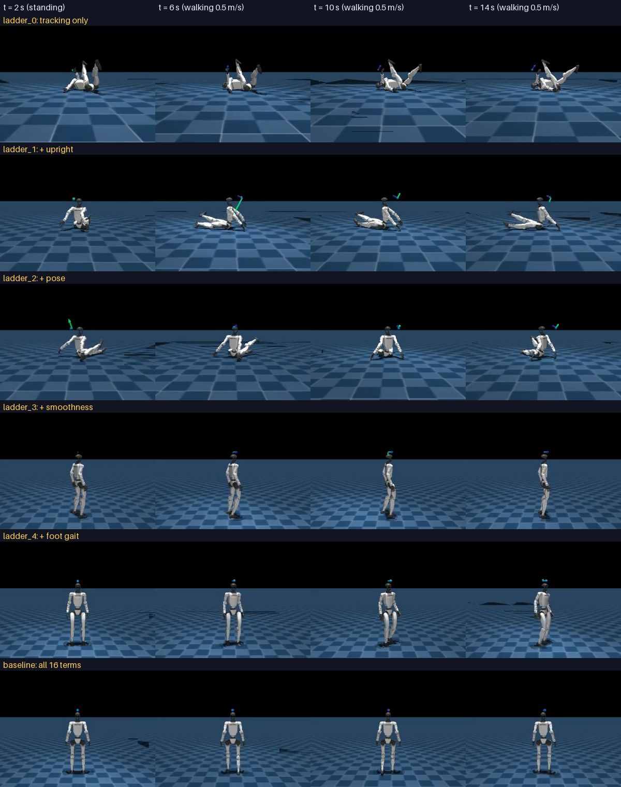

# What does each reward term teach the robot?

A study of the 16 reward terms in Unitree's G1 walking task (`Unitree-G1-Flat`, mjlab 1.2.0, `rsl_rl` PPO): what each
one computes, and what the robot learns, or fails to learn, with and without it.

- Generated charts and the full evaluation table: [results.md](results.md) (rebuilt with
  [`training/study.py`](../study.py) after every round).
- Variants: [`training/variants.py`](../variants.py). Plan: [PLAN.md](../../PLAN.md), Track 1.
- Runs, checkpoints and videos: private Kaggle dataset `sakshaymahna/g1-walking-runs` and the outputs of the training
  notebook's versions (listed per run in [results.md](results.md)).

## Method

- **Add one in:** start from velocity tracking only, add terms in groups (ladder steps 0-8). Step 8 is the full
  reward set, i.e. the baseline. Shows what each group *builds*.
- **Leave one out:** the full reward set without one term. Shows what each term *protects against*.
- Everything else identical: same task, robot, observations, randomization, PPO settings; 4096 robots, **1000
  iterations**, seed 1 (a second seed where an effect is small or surprising).
- Each policy is checked three ways: its **training curves** (every term, every iteration), **videos in its training
  simulator** (MuJoCo Warp), and the **evaluation report** in plain MuJoCo ([`report.py`](../report.py): tracking, gait,
  effort, posture, robustness).
- A prediction is written down before each result.

## The 16 terms

$$v$$, $$\omega$$: base linear and angular velocity (pelvis frame), $$c$$: velocity command, $$g$$: gravity in the torso
frame, $$q$$: joint angles, $$a$$: policy action. "When moving" = only while the command is larger than 0.1 (0.01
for `foot_slip`). Weights as in Unitree's G1 config.

| Step | Term | Weight | Computes | Purpose |
|---|---|---|---|---|
| 0 | `track_linear_velocity` | +1.0 | $$\exp(-(\lVert c_{xy}-v_{xy}\rVert^2 + 2v_z^2)/0.25)$$ | follow the forward/sideways command, don't bounce |
| 0 | `track_angular_velocity` | +1.0 | $$\exp(-((c_z-\omega_z)^2 + 0.05\lVert\omega_{xy}\rVert^2)/0.5)$$ | follow the turn command, don't rock |
| 0 | `is_terminated` | −200 | 1 when the episode ends by a fall (torso tilted > 70°) | don't fall |
| 1 | `body_orientation_l2` | −1.0 | $$\lVert g_{xy}\rVert^2$$ of the torso | keep the torso upright |
| 2 | `pose` | +1.0 | $$\exp(-\text{mean}((q-q_0)^2/\sigma^2))$$, $$\sigma$$ per joint and per speed (0.05 rad standing) | stay near the default posture |
| 3 | `action_rate_l2` | −0.05 | $$\lVert a_t - a_{t-1}\rVert^2$$ | no jumpy actions |
| 3 | `joint_acc_l2` | −2.5e-7 | $$\lVert\ddot q\rVert^2$$ | no violent joint accelerations |
| 4 | `foot_gait` | +0.5 | share of feet whose contact matches the gait clock (stance when phase < 0.56, right foot half a period after the left), when moving | step on the clock's rhythm |
| 5 | `foot_clearance` | −1.0 | $$\sum_\text{feet} \lvert z_\text{foot} - 0.10\rvert \cdot \lVert v_{\text{foot},xy}\rVert$$, when moving | lift moving feet to 10 cm |
| 5 | `foot_slip` | −0.25 | $$\sum_\text{feet in contact} \lVert v_{\text{foot},xy}\rVert^2$$, when moving | don't skid |
| 5 | `soft_landing` | −0.001 | contact force at each touchdown, when moving | land softly |
| 6 | `stand_still` | −1.0 | $$\lVert q - q_0\rVert^2$$ when the command is ~0 | really stand still |
| 7 | `body_ang_vel` | −0.05 | $$\lVert\omega_{xy}\rVert^2$$ of the torso | no torso wobble |
| 7 | `angular_momentum` | −0.025 | $$\lVert L\rVert^2$$, whole-body angular momentum | no swinging |
| 8 | `joint_pos_limits` | −10 | how far joints go past their soft limits | stay inside the joint range |
| 8 | `self_collisions` | −1.0 | steps with a self-contact force over 10 N | legs and arms don't collide |

## Results

*Each policy in its own training simulator (MuJoCo Warp), standing for 4 s, then told to walk at 0.5 m/s.*

| Policy (1000 it) | Pelvis height in training sim | Speed at 0.5 m/s command (training sim) | Plain MuJoCo |
|---|---|---|---|
| step 0: tracking only | 0.11 m (lying on its back) | 0.00 m/s | "falls" (pelvis below 0.4 m) |
| step 1: + upright | 0.14 m (sitting, propped on its arms) | 0.07 m/s | "falls" |
| step 2: + pose | 0.14 m (sitting upright) | 0.03 m/s | "falls" |
| step 3: + smoothness | 0.79 m | 0.46 m/s | walks (shuffling) |
| step 4: + foot gait | 0.78 m | 0.53 m/s | walks |
| full set (baseline) | 0.78 m | 0.48 m/s | walks |

### Steps 0-2: the robot learns to sit down (`ladder_0`, `ladder_1`, `ladder_2`)

**Predictions:** step 0 moves in some ugly way; step 1 keeps the torso upright; step 2 keeps a posture near the default.

**What they learned instead: to sit or lie on the floor and do (almost) nothing.** Step 0 lies on its back with its
legs in the air, step 1 sits propped on its arms, step 2 sits upright. None of them ever walks (0.00-0.07 m/s when
told to walk at 0.5 m/s). During training their episodes almost always reach the 20 s limit, as if they never fall.

**Why this is the best strategy the rewards allow:**

1. **The fall check ignores height.** An episode ends (with the −200 `is_terminated` penalty) only when the pelvis
   tilts more than 70°. Sitting or lying with the pelvis fairly upright is never a "fall".
2. **The tracking rewards pay for doing nothing.** They are $$\exp(-\text{error}^2/\sigma^2)$$: a robot that never moves
   still gets $$\exp(-c^2/\sigma^2)$$. Averaged over the training commands (forward −0.5 to 1.0 m/s, sideways ±0.5,
   turning ±1 rad/s, 5 % standing), a robot that never moves collects **43 % of the maximum linear-tracking reward
   and 62 % of the angular one**, at every step.
3. So sitting down is safe (no fall penalty, ever) and pays almost half of what walking would. Learning to walk
   needs a long phase of falling (−200 each time) before it pays more. With only the tracking rewards, PPO settles on
   sitting: it learns to "survive" by iteration ~70, three times sooner than the full reward set needs to stand.

**What the extra terms changed:** the upright term (step 1) made the robot sit up instead of lying on its back, and
it reduced turning (the turning reward fell from 0.18 to 0.09: turning while sitting means rocking, which the upright
term penalizes). The pose term (step 2) paid briefly while the robot was still upright (0.09 at iteration 110) and
then nothing once it sat down: see "Why the pose reward stops working" below.

**Correction:** after round 1, from the plain-MuJoCo results alone, I guessed these policies balanced with jerky control
that only works in their own simulator. The videos show they never balanced at all: they sat down. Plain MuJoCo
reported "falls" because my evaluation counts a pelvis below 0.4 m as a fall.

**Why the pose reward stops working (step 2):** it is $$\exp(-\text{mean}((q-q_0)^2/\sigma^2))$$ with tight
tolerances (0.05 rad when standing, 0.1-0.5 rad when walking). Close to the default pose it pays and pulls the joints
back; far from it (sitting), the reward and its gradient are practically zero. In the full set the same term rises
steadily to 0.71, because the robot stays near the default pose there.

**Lesson:** a reward is only as good as its loopholes. "Don't fall" defined as "don't tilt" allows sitting, and an
exponential tracking reward pays for standing still. Exponential ("Gaussian") rewards also only guide a policy that is
already close to their target.

### Step 3: + smoothness (`ladder_3`: `action_rate_l2`, `joint_acc_l2`)

**Prediction:** less jitter; the sitting strategy probably stays.

**What it learned: to stand up and walk**, the first policy that does. In plain MuJoCo it stands still (0.01 m),
walks at 0.49 m/s (command 0.5) and 0.90 (command 1.0), steps sideways (0.24) and turns (0.44 rad/s), survives all
four pushes, and walks on friction 0.3 and 1.2. Training rewards: tracking 0.77 / 0.67, pose 0.80 (higher than the
full set: it stays closest to the default pose).

**But it shuffles.** 6.1 steps per second with 0.09 s in the air per step, feet lifted only 1.4 cm, sliding 16 cm/s
while on the ground, both feet down 39 % of the time (baseline: 3.3 steps/s, 0.25 s, 3.5 cm, 5 cm/s, 17 %). It also
has **a dead zone**: at 0.2 m/s it barely moves (0.07 m/s), like `walk.onnx` in Week 2, which was also trained without
a gait reward. And it is the only trained policy so far that stands still **without armature** (0.03 m).

**Why smoothness turned sitting into standing** is not clear from one run; the most likely reading is that sitting and
lying policies rely on large, fast joint motions (getting down, rocking, propping), which these terms make expensive,
so standing became the cheaper way to keep the tracking reward. To check: a second seed, and the leave-one-out runs.

### Step 4: + foot gait (`ladder_4`)

**Prediction:** proper alternating steps on the gait clock's rhythm.

**What it learned:** exactly that. 3.38 steps per second (the gait clock's 0.6 s period: one step per foot per
period), 0.25 s in the air, 2.5 cm clearance, 5.5 cm/s slip, 16 % double support. **The dead zone disappears**
(0.24 m/s at a 0.2 command): the gait reward makes the policy step even when the command is small. This is the Week 2
gait-clock result seen from the reward side. Its walking is already close to the full set; it loses the ability to
stand without armature.

### The reference: full reward set at 1000 iterations (`baseline`, round 2)

**Training:** episodes reach the 20 s limit by about iteration 250-300 (later than steps 0-2: it has 16 goals at
once). Mean reward 32.3 at iteration 1000 (39.2 after 3000).

**Plain MuJoCo:** walks properly. Stands still (0.00 m in 12 s), tracks 0.2 / 0.5 / 1.0 m/s as 0.24 / 0.49 / 0.96,
sideways 0.20, turning 0.44 rad/s; survives all four pushes; walks on friction 0.3 and 1.2. Compared with the same
setup after 3000 iterations: the same behaviour, slightly *better* at slow speed (0.24 vs 0.18 at 0.2 m/s), a little
lower feet (3.5 vs 4.8 cm clearance). Like every trained run so far (but not Unitree's released policy), it falls
standing still without armature.

**So 1000 iterations is enough for the full reward set**, and this run is the reference every ladder step is compared
with.

### Steps 5 and 6: + feet, + stand still (`ladder_5`, `ladder_6`)

**Predictions:** step 5 (`foot_clearance`, `foot_slip`, `soft_landing`) lifts the feet higher and stops skidding;
step 6 (`stand_still`) makes standing quieter.

**What changed** (plain MuJoCo, compared with step 4):

| | Step 4 | Step 5: + feet | Step 6: + stand still | Full set |
|---|---|---|---|---|
| foot clearance | 2.5 cm | **3.4 cm** | 2.9 cm | 3.5 cm |
| foot slip in stance | 5.5 cm/s | **4.9 cm/s** | 4.5 cm/s | 5.0 cm/s |
| turning (command 0.5 rad/s) | 0.45 | **0.52** | 0.52 | 0.44 |
| slow walking (command 0.2 m/s) | 0.24 | 0.17 | 0.19 | 0.24 |
| standing still, 12 s | 0.00 m | 0.00 m | 0.02 m | 0.00 m |

Step 5 does what its terms ask, a little: feet lift ~1 cm higher and slip a little less (the clearance target is
10 cm, but the penalty is weighted by foot speed, so it only pushes swinging feet up). Step 6 shows no effect in these
tests: standing was already still without `stand_still`.

**These effects are small**, about the size of the differences between two seeds of the same setup (the two 3000-
iteration baselines differ by 0.1 cm in clearance, 0.3 cm/s in slip, 0.02-0.04 m/s in tracking). One seed per step
cannot separate them from chance. **So the order matters: steps 0-4 build the gait (stand up, then step), steps 5-8
fine-tune it.** For the fine-tuning terms, the leave-one-out runs (full set minus one term) are the better test.

### Steps 7-8, leave-one-out, observations

Pending (rounds 5 onwards).

## Log

| Round | Notebook version | Runs | Status |
|---|---|---|---|
| 1 | 5 | `ladder_0`, `ladder_1` | done |
| 2 | 6 | `baseline` (1000 it), `ladder_2` | done (videos failed: fixed for round 3) |
| 3 | 7 | `ladder_3`, `ladder_4`, + training-simulator videos of `ladder_0`-`ladder_2` and `baseline` | done (6 videos took 80 min: now every 2nd frame, both GPUs) |
| 4 | 8 | `ladder_5`, `ladder_6` | done (`ladder_6` video failed: EGL device fix) |
| 5 | 9 | `ladder_7`, `loo_foot_gait`, + video of `ladder_6` | running |
