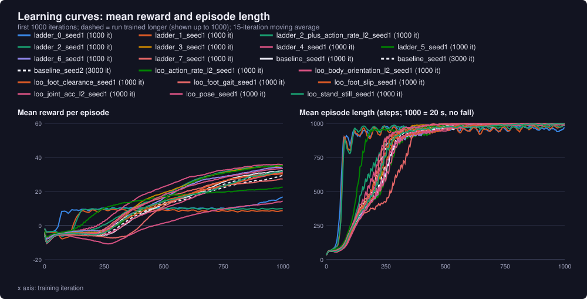
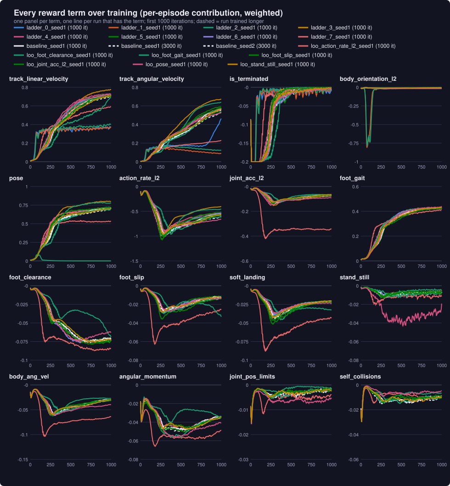

# Reward study: generated results

Generated by [`training/study.py`](../study.py) from the downloaded runs; do not edit by hand. The analysis is in [README.md](README.md).

## Runs

| Run | Reward terms | Notebook version | Iterations |
|---|---|---|---|
| ladder_0_seed1 (1000 it) | 3: track_linear_velocity, track_angular_velocity, is_terminated | v5 | 1000 |
| ladder_1_seed1 (1000 it) | 4: track_linear_velocity, track_angular_velocity, is_terminated, body_orientation_l2 | v5 | 1000 |
| ladder_2_seed1 (1000 it) | 5: track_linear_velocity, track_angular_velocity, is_terminated, body_orientation_l2, pose | v6 | 1000 |
| ladder_3_seed1 (1000 it) | 7: track_linear_velocity, track_angular_velocity, is_terminated, body_orientation_l2, pose, action_rate_l2, joint_acc_l2 | v7 | 1000 |
| ladder_4_seed1 (1000 it) | 8: track_linear_velocity, track_angular_velocity, is_terminated, body_orientation_l2, pose, action_rate_l2, joint_acc_l2, foot_gait | v7 | 1000 |
| baseline_seed1 (1000 it) | 16: track_linear_velocity, track_angular_velocity, is_terminated, body_orientation_l2, pose, action_rate_l2, joint_acc_l2, foot_gait, foot_clearance, foot_slip, soft_landing, stand_still, body_ang_vel, angular_momentum, joint_pos_limits, self_collisions | v6 | 1000 |
| baseline_seed1 (3000 it) | 16: track_linear_velocity, track_angular_velocity, is_terminated, body_orientation_l2, pose, action_rate_l2, joint_acc_l2, foot_gait, foot_clearance, foot_slip, soft_landing, stand_still, body_ang_vel, angular_momentum, joint_pos_limits, self_collisions | v4 | 3000 |
| baseline_seed2 (3000 it) | 16: track_linear_velocity, track_angular_velocity, is_terminated, body_orientation_l2, pose, action_rate_l2, joint_acc_l2, foot_gait, foot_clearance, foot_slip, soft_landing, stand_still, body_ang_vel, angular_momentum, joint_pos_limits, self_collisions | v4 | 3000 |

## Learning curves

## Evaluation in plain MuJoCo ([`report.py`](../report.py))

Unitree's model, 5 ms physics, policy every 20 ms. "fell" = pelvis below 0.4 m; "unstable" = the policy drove MuJoCo's simulation to infinite accelerations.

| | Unitree (released) | ladder_0_seed1 (1000 it) | ladder_1_seed1 (1000 it) | ladder_2_seed1 (1000 it) | ladder_3_seed1 (1000 it) | ladder_4_seed1 (1000 it) | baseline_seed1 (1000 it) | baseline_seed1 (3000 it) | baseline_seed2 (3000 it) |
|---|---|---|---|---|---|---|---|---|---|
| tracking: stand | 0.01 m | fell | fell | fell | 0.01 m | 0.00 m | 0.00 m | 0.01 m | 0.02 m |
| tracking: vx 0.2 | +0.22 m/s | fell | fell | fell | +0.07 m/s | +0.24 m/s | +0.24 m/s | +0.18 m/s | +0.19 m/s |
| tracking: vx 0.5 | +0.50 m/s | fell | fell | fell | +0.49 m/s | +0.53 m/s | +0.49 m/s | +0.45 m/s | +0.46 m/s |
| tracking: vx 1.0 | +1.02 m/s | fell | fell | fell | +0.90 m/s | +1.02 m/s | +0.96 m/s | +1.03 m/s | +0.99 m/s |
| tracking: vy 0.3 | +0.24 m/s | fell | fell | fell | +0.24 m/s | +0.25 m/s | +0.20 m/s | +0.24 m/s | +0.24 m/s |
| tracking: wz 0.5 | +0.53 rad/s | fell | fell | fell | +0.44 rad/s | +0.45 rad/s | +0.44 rad/s | +0.46 rad/s | +0.44 rad/s |
| gait: steps per second | 3.38 |  |  |  | 6.12 | 3.38 | 3.25 | 3.38 | 3.25 |
| gait: air time per step (s) | 0.27 |  |  |  | 0.09 | 0.25 | 0.25 | 0.25 | 0.26 |
| gait: foot clearance (cm) | 7.0 |  |  |  | 1.4 | 2.5 | 3.5 | 4.8 | 4.9 |
| gait: foot slip in stance (cm/s) | 5.6 |  |  |  | 16.1 | 5.5 | 5.0 | 4.2 | 3.9 |
| gait: double support (%) | 12 |  |  |  | 39 | 16 | 17 | 15 | 14 |
| effort: action rate | 0.676 |  |  |  | 0.827 | 0.452 | 0.426 | 0.672 | 0.596 |
| effort: joint acceleration RMS (rad/s²) | 42.7 |  |  |  | 56.5 | 40.8 | 39.2 | 40.5 | 38.9 |
| effort: torque RMS (N·m) | 7.1 |  |  |  | 6.9 | 6.5 | 6.6 | 6.8 | 6.8 |
| effort: mechanical power (W) | 90 |  |  |  | 100 | 81 | 72 | 82 | 80 |
| posture: torso tilt (deg) | 0.8 |  |  |  | 2.0 | 1.4 | 1.2 | 0.8 | 1.4 |
| posture: pelvis height (m) | 0.780 |  |  |  | 0.787 | 0.785 | 0.784 | 0.784 | 0.785 |
| posture: distance from default pose (rad RMS) | 0.105 |  |  |  | 0.051 | 0.063 | 0.070 | 0.082 | 0.081 |
| robustness: pushes survived (of 4) | 4 |  |  |  | 4 | 4 | 4 | 4 | 4 |
| robustness: friction 0.3, vx 0.5 | +0.49 m/s |  |  |  | +0.50 m/s | +0.52 m/s | +0.48 m/s | +0.44 m/s | +0.46 m/s |
| robustness: friction 1.2, vx 0.5 | +0.51 m/s |  |  |  | +0.48 m/s | +0.54 m/s | +0.50 m/s | +0.46 m/s | +0.47 m/s |
| robustness: no armature, stand | 0.05 m |  |  |  | 0.03 m | fell | fell | fell | fell |
| robustness: no armature, vx 0.5 | +0.46 m/s |  |  |  | +0.50 m/s | +0.55 m/s | +0.57 m/s | +0.47 m/s | +0.47 m/s |
| gait, effort, posture at 0.5 m/s |  | fell | fell | fell |  |  |  |  |  |
| training: iterations |  | 999 | 999 | 999 | 999 | 999 | 999 | 2999 | 2999 |
| training: mean reward |  | 17.08 | 8.61 | 9.83 | 35.18 | 35.83 | 32.31 | 39.20 | 39.68 |
| training: episode length |  | 980.44 | 994.24 | 981.92 | 1000.00 | 988.90 | 1000.00 | 992.58 | 1000.00 |
| training: track_linear_velocity |  | 0.3734 | 0.3687 | 0.4040 | 0.7669 | 0.7316 | 0.7063 | 0.7688 | 0.7739 |
| training: track_angular_velocity |  | 0.4662 | 0.0881 | 0.1218 | 0.6706 | 0.5612 | 0.5726 | 0.6780 | 0.6815 |
| training: is_terminated |  | -0.0072 | -0.0037 | -0.0044 | 0.0000 | -0.0029 | 0.0000 | -0.0017 | 0.0000 |
| training: body_orientation_l2 |  |  | -0.0183 | -0.0176 | -0.0063 | -0.0094 | -0.0055 | -0.0049 | -0.0053 |
| training: pose |  |  |  | 0.0000 | 0.7981 | 0.7138 | 0.7144 | 0.7487 | 0.7492 |
| training: joint_acc_l2 |  |  |  |  | -0.0816 | -0.0715 | -0.0667 | -0.0550 | -0.0557 |
| training: action_rate_l2 |  |  |  |  | -0.4059 | -0.5441 | -0.5591 | -0.4412 | -0.4461 |
| training: foot_gait |  |  |  |  |  | 0.4264 | 0.4339 | 0.4388 | 0.4409 |
| training: body_ang_vel |  |  |  |  |  |  | -0.0293 | -0.0231 | -0.0232 |
| training: angular_momentum |  |  |  |  |  |  | -0.0338 | -0.0263 | -0.0262 |
| training: joint_pos_limits |  |  |  |  |  |  | -0.0014 | -0.0010 | -0.0004 |
| training: foot_clearance |  |  |  |  |  |  | -0.0729 | -0.0652 | -0.0646 |
| training: foot_slip |  |  |  |  |  |  | -0.0132 | -0.0106 | -0.0095 |
| training: soft_landing |  |  |  |  |  |  | -0.0208 | -0.0181 | -0.0192 |
| training: stand_still |  |  |  |  |  |  | -0.0049 | -0.0045 | -0.0043 |
| training: self_collisions |  |  |  |  |  |  | -0.0091 | -0.0065 | -0.0067 |
